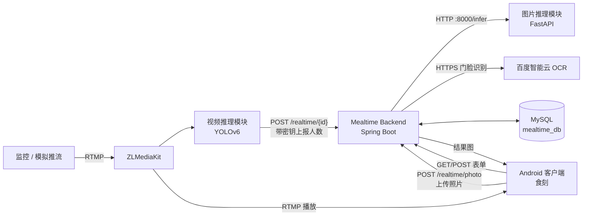
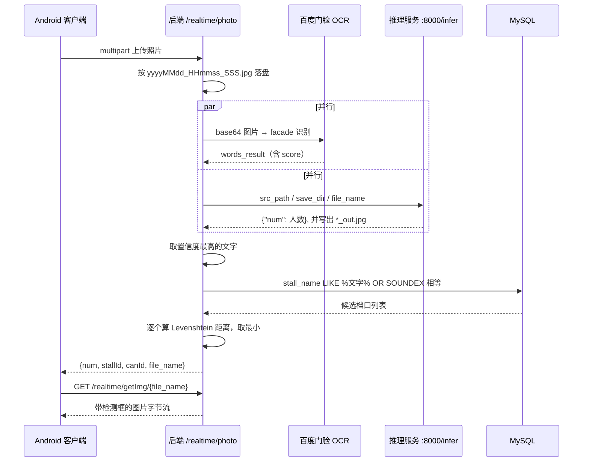
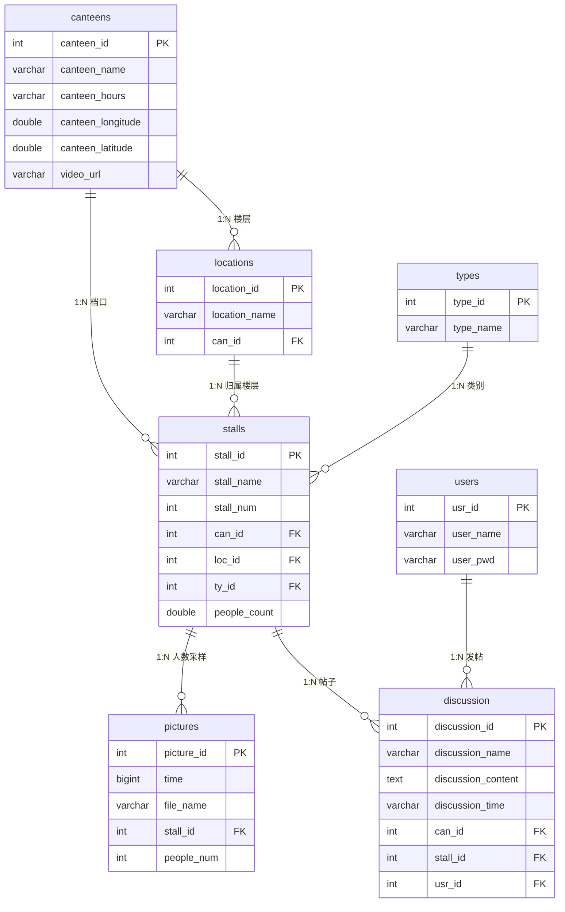
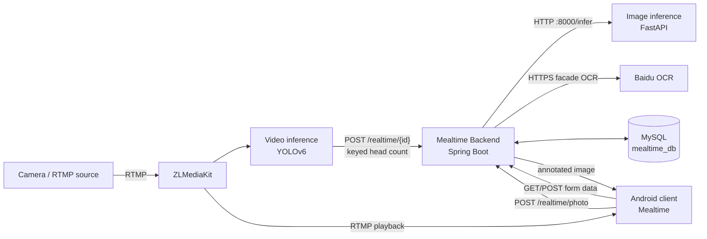
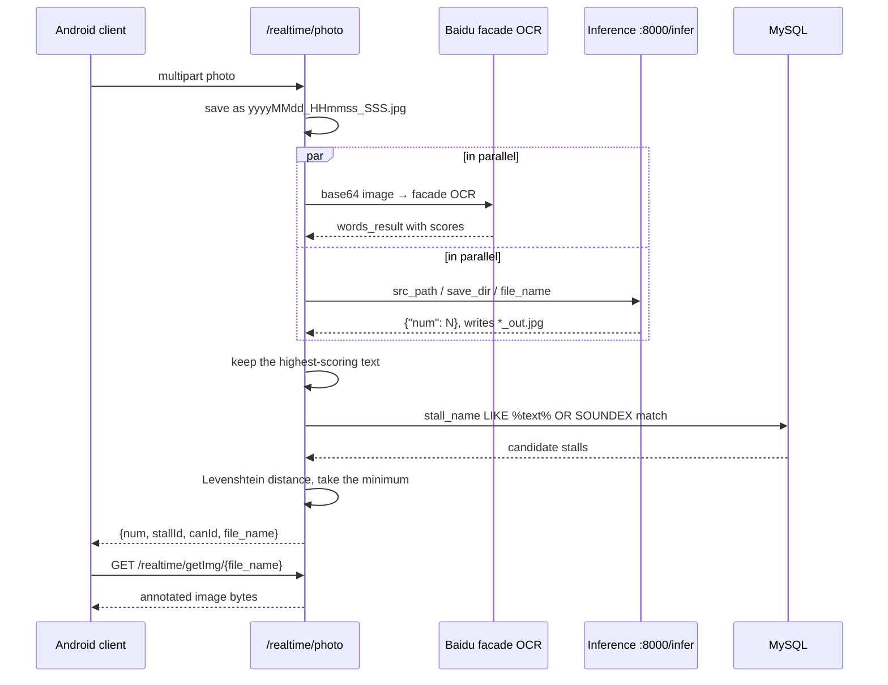
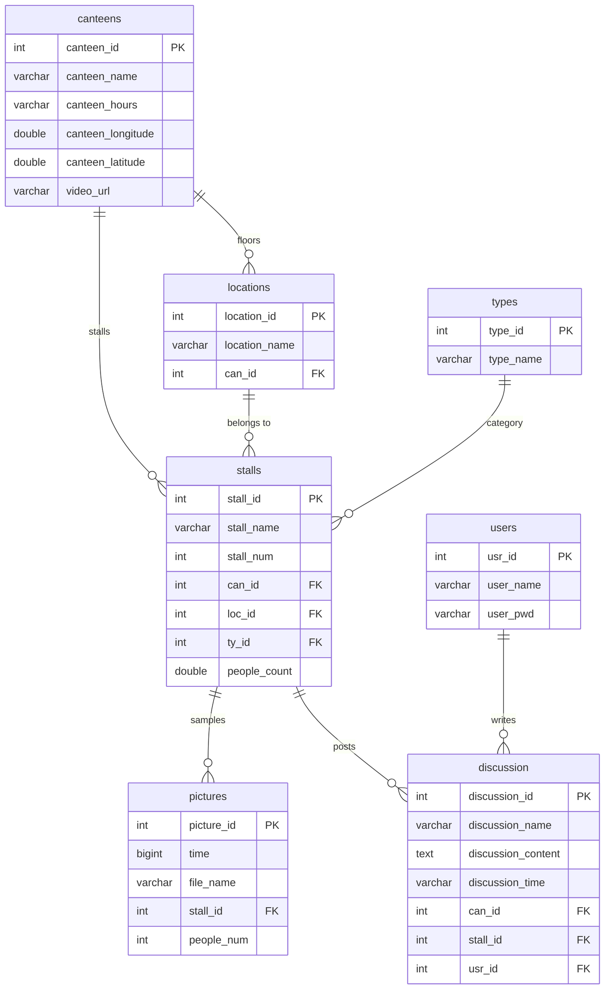

# 食刻 Mealtime Backend

> 校园食堂人流监控系统的服务端：数据管理、REST 接口与图片推理编排
> The server side of a campus canteen crowd-monitoring system: data, REST APIs and photo inference orchestration.

[简体中文](#zh) · [English](#en)


---

<a id="zh"></a><a name="zh"></a>

## 中文版

### 项目简介

这是本科毕业设计《基于视频的人流监控系统的设计与实现》的**服务端**，也是 Android 客户端「食刻」的唯一数据来源。它本身不做目标检测，而是站在中间做三件事：把食堂、档口、用户、帖子、照片这些数据管好；把客户端要的数据按需查询、组织成 JSON 返回；在用户上传照片时，同时调用文字识别与人流推理两个外部服务，把结果拼成一条可以直接展示的回答。

具体职责：

- 提供 7 张业务表的 REST 接口，支持按食堂 / 楼层 / 类别 / 关键词组合筛选；
- 接收客户端上传的档口照片，落盘后**并行**调用百度门脸文字识别与本地推理服务，再用编辑距离匹配出最可能的档口；
- 按时间指数衰减，把一段时间内针对同一档口的多条人数记录合成一个可信流量值；
- 作为图片中转站，把带检测框的结果图回传给客户端；
- 内置一个每秒运行的人流模拟器，让整套系统在没有真实摄像头和 GPU 的环境下也能演示。

### 在系统中的位置



后端不直接参与视频链路：视频推理模块算完人数后，用带密钥的 `POST /realtime/{id}` 把数字推进内存列表，客户端每秒 `GET /realtime` 把它读走。图片链路则相反，后端是编排者，外部服务只负责"看"。

### 接口总览

所有接口都以表单参数（`application/x-www-form-urlencoded`）或路径参数交互，返回 JSON，没有统一的响应包装体。

| 模块 | 方法与路径 | 说明 |
| --- | --- | --- |
| 食堂 | `GET /canteens` | 全部食堂：名称、营业时间、经纬度、`videoUrl` |
| 食堂 | `GET /canteens/{id}` | 单个食堂 |
| 食堂 | `POST` / `PUT` / `DELETE /canteens` | 新增、修改、删除 |
| 实时人数 | `GET /realtime` | 各食堂当前人数数组，客户端每秒轮询 |
| 实时人数 | `POST /realtime/{id}?num=&key=` | 由视频推理模块上报，需密钥校验 |
| 档口 | `GET /stalls?canId=&locId=&tyId=&stallName=` | 条件筛选，全部可选 |
| 档口 | `POST /stalls/addPic` | 提交一条人数记录，触发流量重算 |
| 档口 | `GET /stalls/{id}`、`POST/PUT/DELETE /stalls` | 单查与增删改 |
| 字典 | `GET /types` · `GET /locations` | 档口类别、楼层列表，供筛选项使用 |
| 图片 | `POST /realtime/photo` | 上传照片，返回人数、档口、食堂与结果文件名 |
| 图片 | `GET /realtime/getImg/{file_name}` | 下载带检测框的结果图 |
| 论坛 | `GET /discussion?discussionName=&canId=&stallId=` | 按标题/内容模糊搜索，按食堂、档口筛选 |
| 论坛 | `POST /discussion` | 发帖 |
| 用户 | `POST /users` | 注册，用户名已存在返回 `-1` |
| 用户 | `POST /users/Login` | 登录，返回用户列表（空列表即失败） |
| 用户 | `GET /users` | 用户名是否已被占用 |

> 注意：客户端代码里的 `server_url` 带 `/mealtimeServer/` 前缀，而本项目并未设置 `server.servlet.context-path`，说明线上是反向代理（如 Nginx）做的前缀转发。本地直连 `:8088` 时，客户端地址需去掉该前缀。

### 核心实现

#### 照片处理流水线

`POST /realtime/photo` 是整个后端里逻辑最重的一个接口，一次请求要串起三条链路。



两个外部调用用 `CompletableFuture` 并行，整体耗时取决于较慢的一侧而不是两者之和。文字识别的结果先按 `score` 取最高的字符串，再用 SQL 的模糊匹配加 `SOUNDEX` 捞候选，最后在 Java 里用编辑距离挑最接近的档口名——这样即使 OCR 有一两个字识别错，只要整体形近仍能命中。推理服务的返回里直接带上 `num`，后端只负责透传和补充 `stallId`、`canId`。

文件命名用毫秒级时间戳，推断服务在原名后加 `_out` 存结果图，所以下载接口拿到 `file_name` 后拼 `_out.jpg` 即可定位。

#### 档口流量的指数加权

单个用户拍的照片可能偏差很大，所以不直接采用。每次 `addPic` 插入一条记录后，异步重算该档口最近 30 分钟的数据：

$$\text{flow} = \frac{\sum_i w_i \cdot n_i}{\sum_i w_i}, \qquad w_i = 0.8^{\,t_i}$$

其中 flow 是该档口的加权人数，$n_i$ 为第 $i$ 条记录的人数，$t_i$ 是记录距当前时间的分钟数。每过一分钟权重衰减到 0.8，半小时前的数据权重只剩约 0.001，等于自然淘汰。计算落在独立线程里，不阻塞提交请求的响应。

#### 食堂实时人数的两条来源

`GET /realtime` 返回的是一个长度与食堂数一致的内存列表，它有两个写入方：

- **真实链路**：视频推理模块每秒调用 `POST /realtime/{id}?num=…&key=…`，密钥不匹配则静默丢弃，防止被随意篡改；
- **演示链路**：`@Scheduled(cron = "*/1 * * * * *")` 每秒对第 2~4 个元素做 ±6 的随机游走，并钳制在 0~75，模拟人数波动。

两者写的是同一个列表。**这意味着开启演示模拟器时，真实上报的数字每秒都会被随机游走覆盖**，接入真实推理前应当先把 `simulate()` 停掉或加开关。

#### 论坛的联表查询

`discussion` 与 `users` 内连接取发帖人昵称，按 `discussion_id` 倒序；关键词同时匹配标题与正文，食堂和档口是精确条件，三者可任意组合。返回体里额外带了 `userName`，避免客户端二次请求。

### 数据库设计



`stalls.people_count` 是冗余字段，存的就是上文加权算出来的结果，读接口直接取，避免每次查询都扫 `pictures` 表；`pictures` 只作为原始采样池，用于回溯和重算。

仓库没有附带建表脚本，下面这份是**依据实体与 Mapper 反推的参考 DDL**，字段类型按 MySQL 8 惯用写法补齐，落地时请以实际库为准：

```sql
CREATE DATABASE IF NOT EXISTS mealtime_db DEFAULT CHARSET utf8mb4;
USE mealtime_db;

CREATE TABLE canteens (
  canteen_id        INT PRIMARY KEY AUTO_INCREMENT,
  canteen_name      VARCHAR(64)  NOT NULL,
  canteen_hours     VARCHAR(64),
  canteen_longitude DOUBLE,
  canteen_latitude  DOUBLE,
  video_url         VARCHAR(255)
);

CREATE TABLE locations (
  location_id   INT PRIMARY KEY AUTO_INCREMENT,
  location_name VARCHAR(32) NOT NULL,
  can_id        INT
);

CREATE TABLE types (
  type_id   INT PRIMARY KEY AUTO_INCREMENT,
  type_name VARCHAR(32) NOT NULL
);

CREATE TABLE stalls (
  stall_id     INT PRIMARY KEY AUTO_INCREMENT,
  stall_name   VARCHAR(64) NOT NULL,
  stall_num    INT,
  can_id       INT,
  loc_id       INT,
  ty_id        INT,
  people_count DOUBLE DEFAULT 0
);

CREATE TABLE users (
  usr_id    INT PRIMARY KEY AUTO_INCREMENT,
  user_name VARCHAR(32) UNIQUE NOT NULL,
  user_pwd  VARCHAR(64) NOT NULL
);

CREATE TABLE discussion (
  discussion_id      INT PRIMARY KEY AUTO_INCREMENT,
  discussion_name    VARCHAR(128) NOT NULL,
  discussion_content TEXT,
  discussion_time    VARCHAR(32),
  can_id             INT,
  stall_id           INT,
  usr_id             INT
);

CREATE TABLE pictures (
  picture_id INT PRIMARY KEY AUTO_INCREMENT,
  time       BIGINT,
  file_name  VARCHAR(64),
  stall_id   INT,
  people_num INT
);
```

### 技术栈

| 分类 | 选型 | 说明 |
| --- | --- | --- |
| 语言 | Java 17 | `pom.xml` 中 `java.version=17` |
| 框架 | Spring Boot 3.2.5 | Web + JDBC + AOP + DevTools |
| 持久层 | MyBatis 3.0.3 | XML Mapper 写在 `resources/mapper`，开启驼峰映射 |
| 数据库 | MySQL 8（`mysql-connector-j` 8.4.0） | 连接串带 `useUnicode` / `serverTimezone` |
| 连接池 | HikariCP | Spring Boot 默认，未额外配置 |
| HTTP 客户端 | OkHttp 4.12.0 + `HttpURLConnection` | 调百度 OCR 用前者，调推理服务用后者 |
| JSON | fastjson2 2.0.49 + org.json | 前者处理实体，后者拼推理请求 |
| 工具 | Lombok、PageHelper 2.1.0、jsqlparser 4.6 | PageHelper 已引入但当前查询并未真正分页 |
| 构建 | Maven Wrapper（`mvnw`） | 免装 Maven，`./mvnw spring-boot:run` 即可 |

### 目录结构

```
Mealtime-Backend/
├── src/main/java/com/cqu/mealtime/
│   ├── MealtimeApplication.java     启动类，@MapperScan 扫描 dao 包
│   ├── controller/                  7 个控制器，一表一个
│   │   ├── CanteensController.java
│   │   ├── StallsController.java    含 addPic 与流量重算
│   │   ├── RealTimeController.java  人数列表、照片流水线、结果图下载、模拟器
│   │   ├── DiscussionController.java
│   │   ├── UsersController.java     注册查重与登录校验
│   │   ├── TypesController.java
│   │   └── LocationsController.java
│   ├── service/ + service/impl/     接口与实现，基本是透传
│   ├── dao/                         7 个 MyBatis Mapper 接口
│   ├── entity/                      与表一一对应的 POJO
│   └── util/RequestUtil.java        urlEncode、POST、百度鉴权与 OCR 调用
├── src/main/resources/
│   ├── application.yml              端口、数据源、上传大小、MyBatis 配置
│   └── mapper/*.xml                 7 份 SQL 映射
├── pom.xml                          当前使用的构建配置（Spring Boot 3.2.5）
└── pom1.xml                         早期 Spring Boot 2.7 版本备份，未被使用
```

分层是标准的 Controller → Service → DAO → Mapper XML，Service 层基本只做转发，业务逻辑集中在 `RealTimeController` 和 `StallsController.addPic` 两处。

### 快速开始

1. 环境：JDK 17、MySQL 8（本地或远程均可，需能建库建表）；
2. 建库：执行上文的参考 DDL，并录入食堂、楼层、类别、档口的基础数据（食堂的 `video_url` 填 ZLMediaKit 的 RTMP 播放地址）；
3. 改配置：编辑 `src/main/resources/application.yml`，把 `spring.datasource.url / username / password` 换成你自己的库；
4. 改两处硬编码路径（见下节）：图片落盘目录 `/home/program/mealtime/`、推理服务地址 `http://localhost:8000/infer`；
5. 启动：`./mvnw spring-boot:run`，或 `./mvnw clean package` 后 `java -jar target/mealtime-1.6.jar`，默认端口 `8088`；
6. 自测：浏览器访问 `http://localhost:8088/canteens`，能返回 JSON 数组即表示数据库连通。

若要让照片上传功能完整可用，还需要另外启动图片推理服务（FastAPI，监听 8000，接受 `src_path`/`save_dir`/`file_name` 三个参数并返回 `{"num": N}`），并配置可用的百度智能云 OCR 应用。只做数据查询和论坛时，这两个依赖可以暂时不启动。

### 需要按环境修改的配置

| 位置 | 项目 | 说明 |
| --- | --- | --- |
| `application.yml` | `spring.datasource.*` | 数据库地址、账号、密码 |
| `application.yml` | `server.port` | 默认 8088，被占用时改这里 |
| `RealTimeController` | `imgFilePath` | 图片落盘目录，默认 `/home/program/mealtime/`，Windows 下需改成盘符路径 |
| `RealTimeController` | `doPost("http://localhost:8000/infer", …)` | 图片推理服务地址 |
| `RealTimeController` | `update()` 中的密钥比较 | 视频推理模块上报人数时的校验密钥 |
| `util/RequestUtil` | `API_KEY` / `SECRET_KEY` | 百度智能云应用的 AK/SK |

### 已知问题与改进方向

写在这里的问题都是读代码时发现的真实情况，供后续接手时参考：

- **敏感信息硬编码**：数据库密码写在 `application.yml`，百度 AK/SK 和上报密钥直接写在源码里，且已进入 Git 历史。建议改为环境变量或配置中心注入，并到控制台轮换这些凭据；
- **密码明文存储**：`users.user_pwd` 直接存明文，登录时用 `WHERE user_name=? AND user_pwd=?` 比对。应改为 BCrypt 加盐哈希；
- **模拟器会覆盖真实数据**：`simulate()` 每秒写入同一列表，接入真实视频推理后必须先关掉；
- **接口无鉴权与统一错误处理**：除人数上报外，增删改接口完全开放；也没有全局异常处理，出错时返回的是 Spring 默认错误页而非统一 JSON；
- **路径与依赖写死**：图片目录、推理服务地址、密钥都不可配置，迁移环境需要改代码重新打包；
- **分页未启用**：`pagehelper-spring-boot-starter` 已在依赖里，但 `queryAllByLimit` 实际是"按条件查全部"，数据量上来后需要补上真正的分页；
- **`pom1.xml` 冗余**：早期 Spring Boot 2.7 的配置残留，建议删除以免误用；
- **无建表脚本**：新环境需要手工建表，建议补一份 `schema.sql`（本文档里的参考 DDL 可以作为起点）。

### 版权与致谢

本项目为重庆大学计算机学院本科毕业设计《基于视频的人流监控系统的设计与实现》（作者：吴铭一，学号 20194086，指导教师：周明强副教授，2023 年 6 月）的服务端部分。感谢导师的指导，以及 Spring Boot、MyBatis、OkHttp、百度智能云等开源项目与服务提供方。

---

<a id="en"></a><a name="en"></a>

## English Version

### Overview

This is the **server side** of the thesis *Design and Implementation of a Video-Based People Flow Monitoring System*, and the only data source for the Android client, Mealtime. It performs no detection itself; it sits in the middle and does three things: keep canteens, stalls, users, posts and photos in order; serve the client's queries as JSON; and, when a photo arrives, call two external services at once and stitch their answers into something the app can display directly.

Responsibilities:

- Expose REST endpoints over seven tables, with combinable filters for canteen, floor, category and keyword;
- Accept uploaded stall photos, persist them, call Baidu facade OCR and the local inference service **in parallel**, then match the most likely stall by edit distance;
- Fuse several head-count samples for the same stall into one trustworthy value using exponential time decay;
- Act as an image relay, returning the annotated result picture to the client;
- Ship a once-per-second crowd simulator so the whole system can be demoed without cameras or a GPU.

### Where It Sits



The backend stays out of the video path: the video module pushes counts into an in-memory list via a keyed `POST /realtime/{id}`, and the client polls `GET /realtime` once a second. The photo path is the opposite — here the backend is the orchestrator and the external services only do the looking.

### API Surface

Everything speaks form parameters (`application/x-www-form-urlencoded`) or path variables and returns JSON. There is no shared response envelope.

| Area | Method and path | Notes |
| --- | --- | --- |
| Canteens | `GET /canteens` | All canteens: name, hours, lat/lng, `videoUrl` |
| Canteens | `GET /canteens/{id}` | Single canteen |
| Canteens | `POST` / `PUT` / `DELETE /canteens` | Create, update, delete |
| Live count | `GET /realtime` | Current head counts, polled once per second |
| Live count | `POST /realtime/{id}?num=&key=` | Reported by the video module, key-checked |
| Stalls | `GET /stalls?canId=&locId=&tyId=&stallName=` | All filters optional |
| Stalls | `POST /stalls/addPic` | Submit a sample, triggers recomputation |
| Stalls | `GET /stalls/{id}`, `POST/PUT/DELETE /stalls` | Single read, create, update, delete |
| Dictionaries | `GET /types` · `GET /locations` | Choices for the filter wheels |
| Photos | `POST /realtime/photo` | Upload; returns count, stall, canteen, file name |
| Photos | `GET /realtime/getImg/{file_name}` | Download the annotated image |
| Forum | `GET /discussion?discussionName=&canId=&stallId=` | Fuzzy by title/body, exact by canteen and stall |
| Forum | `POST /discussion` | Create a post |
| Users | `POST /users` | Register; returns `-1` if the name is taken |
| Users | `POST /users/Login` | Sign in; an empty list means failure |
| Users | `GET /users` | Whether a username is taken |

> Note: the client's `server_url` carries a `/mealtimeServer/` prefix, yet this project sets no `server.servlet.context-path`. In production that prefix is added by a reverse proxy such as Nginx. When pointing the app at `:8088` directly, drop the prefix.

### How the Interesting Parts Work

#### The photo pipeline

`POST /realtime/photo` is the heaviest endpoint; one request touches three paths.



The two external calls run through `CompletableFuture`, so total latency tracks the slower side rather than their sum. OCR results are reduced to the highest-scoring string, candidates are pulled with `LIKE` plus `SOUNDEX`, and the final choice is made in Java by edit distance — a character or two of OCR noise usually still lands on the right stall. The inference response already carries `num`; the backend only forwards it and adds `stallId` and `canId`.

Files are named with a millisecond timestamp and the inference service writes the annotated copy with an `_out` suffix, so the download endpoint resolves `file_name` to `<name>_out.jpg` without a lookup table.

#### Exponential weighting for stall queues

A single user's photo can be wildly off, so it is never trusted alone. After each `addPic`, the stall's last 30 minutes are recomputed asynchronously:

$$\text{flow} = \frac{\sum_i w_i \cdot n_i}{\sum_i w_i}, \qquad w_i = 0.8^{\,t_i}$$

with $t_i$ in minutes. Each minute multiplies a sample's weight by 0.8, leaving a half-hour-old sample at roughly 0.001 — effectively aged out. The recomputation runs on its own thread so the submit request returns immediately.

#### Two writers, one list

`GET /realtime` serves an in-memory list sized to the number of canteens, written by two parties:

- **The real path**: the video module posts `POST /realtime/{id}?num=…&key=…` every second; a wrong key is silently dropped so counts cannot be tampered with;
- **The demo path**: `@Scheduled(cron = "*/1 * * * * *")` nudges elements 2–4 by ±6 every second, clamped to 0–75.

Both write the same list, which means **while the simulator is running it overwrites real reports every second**. Turn `simulate()` off before wiring up actual inference.

#### Forum queries

`discussion` inner-joins `users` to carry the author's name, ordered by `discussion_id` descending. The keyword matches title or body, canteen and stall are exact filters, and all three combine freely. `userName` is included so the client needs no second round trip.

### Database Design



`stalls.people_count` is a denormalised cache of the weighted result above, so read endpoints never scan `pictures`; that table stays a raw sample pool for auditing and recomputation.

The repository ships no schema. The DDL in the Chinese section is a **reconstruction from the entities and mappers** with sensible MySQL 8 types — treat it as a starting point, not as the original schema.

### Tech Stack

| Area | Choice | Notes |
| --- | --- | --- |
| Language | Java 17 | `java.version=17` in `pom.xml` |
| Framework | Spring Boot 3.2.5 | Web + JDBC + AOP + DevTools |
| Persistence | MyBatis 3.0.3 | XML mappers under `resources/mapper`, camel-case mapping on |
| Database | MySQL 8 (`mysql-connector-j` 8.4.0) | Connection string carries `useUnicode` / `serverTimezone` |
| Pool | HikariCP | Spring Boot default, untuned |
| HTTP client | OkHttp 4.12.0 and `HttpURLConnection` | The former for Baidu OCR, the latter for inference |
| JSON | fastjson2 2.0.49, org.json | Entities vs. hand-built request bodies |
| Utilities | Lombok, PageHelper 2.1.0, jsqlparser 4.6 | PageHelper is a dependency but no query paginates yet |
| Build | Maven Wrapper (`mvnw`) | `./mvnw spring-boot:run`, no local Maven needed |

### Project Layout

```
Mealtime-Backend/
├── src/main/java/com/cqu/mealtime/
│   ├── MealtimeApplication.java     Entry point, @MapperScan on the dao package
│   ├── controller/                  One controller per table
│   │   ├── StallsController.java    addPic plus the weighting recompute
│   │   ├── RealTimeController.java  Counts, photo pipeline, image download, simulator
│   │   ├── UsersController.java     Registration check and login
│   │   └── …                        Canteens, Discussion, Types, Locations
│   ├── service/ + service/impl/     Thin pass-through services
│   ├── dao/                         Seven MyBatis mapper interfaces
│   ├── entity/                      POJOs mirroring the tables
│   └── util/RequestUtil.java        Form encoding, POST, Baidu auth and OCR
├── src/main/resources/
│   ├── application.yml              Port, datasource, upload limits, MyBatis
│   └── mapper/*.xml                 Seven SQL mappers
├── pom.xml                          The build actually in use (Spring Boot 3.2.5)
└── pom1.xml                         Legacy Spring Boot 2.7 config, unused
```

Layering is the textbook Controller → Service → DAO → XML path, but the services mostly forward calls; the real logic lives in `RealTimeController` and `StallsController.addPic`.

### Getting Started

1. Requirements: JDK 17 and MySQL 8, local or remote, with permission to create databases;
2. Create the schema from the reference DDL above and seed canteens, floors, categories and stalls (`canteens.video_url` should hold the ZLMediaKit RTMP URL);
3. Edit `src/main/resources/application.yml` and point `spring.datasource.url / username / password` at your own database;
4. Fix the two hard-coded paths described below: the image directory `/home/program/mealtime/` and the inference endpoint `http://localhost:8000/infer`;
5. Run `./mvnw spring-boot:run`, or `./mvnw clean package` then `java -jar target/mealtime-1.6.jar`; the port is `8088`;
6. Smoke-test with `http://localhost:8088/canteens` — a JSON array means the datasource is wired up.

Full photo upload additionally needs the FastAPI inference service on port 8000 (accepting `src_path`, `save_dir`, `file_name` and returning `{"num": N}`) and a working Baidu OCR application. Queries and the forum work without either.

### Configuration You Will Need to Change

| Location | Item | Notes |
| --- | --- | --- |
| `application.yml` | `spring.datasource.*` | Host, user, password |
| `application.yml` | `server.port` | 8088 by default |
| `RealTimeController` | `imgFilePath` | Image directory, hard-coded to a Linux path |
| `RealTimeController` | `doPost("http://localhost:8000/infer", …)` | Inference endpoint |
| `RealTimeController` | key comparison in `update()` | Shared secret for count reports |
| `util/RequestUtil` | `API_KEY` / `SECRET_KEY` | Baidu OCR credentials |

### Known Issues

All of the following were found while reading the code and are worth addressing before reuse:

- **Secrets in the repository**: the database password sits in `application.yml`, and the Baidu AK/SK plus the report key are compiled into source — all of it already in Git history. Move them to environment variables or a config server and rotate the credentials;
- **Plaintext passwords**: `users.user_pwd` stores plain text and login compares it in SQL. Use a salted hash such as BCrypt;
- **The simulator overwrites real data**: `simulate()` writes the same list every second, so it must be disabled once real inference is connected;
- **No auth and no unified error handling**: apart from count reports, write endpoints are wide open, and failures return Spring's default error page rather than a JSON envelope;
- **Hard-coded environment**: image directory, inference URL and secrets cannot be configured without a rebuild;
- **Pagination is a no-op**: `pagehelper-spring-boot-starter` is declared, but `queryAllByLimit` fetches everything matching the filters;
- **`pom1.xml` is dead weight**: a leftover Spring Boot 2.7 configuration that should be deleted to avoid confusion;
- **No schema script**: new environments need hand-built tables; adding a `schema.sql` (the DDL here is a reasonable start) would help.

### Credits

The server side of the undergraduate thesis *Design and Implementation of a Video-Based People Flow Monitoring System* (Wu Mingyi, 20194086; advisor: Assoc. Prof. Zhou Mingqiang; College of Computer Science, Chongqing University, June 2023). Thanks to the advisor, and to Spring Boot, MyBatis, OkHttp and Baidu Cloud.
